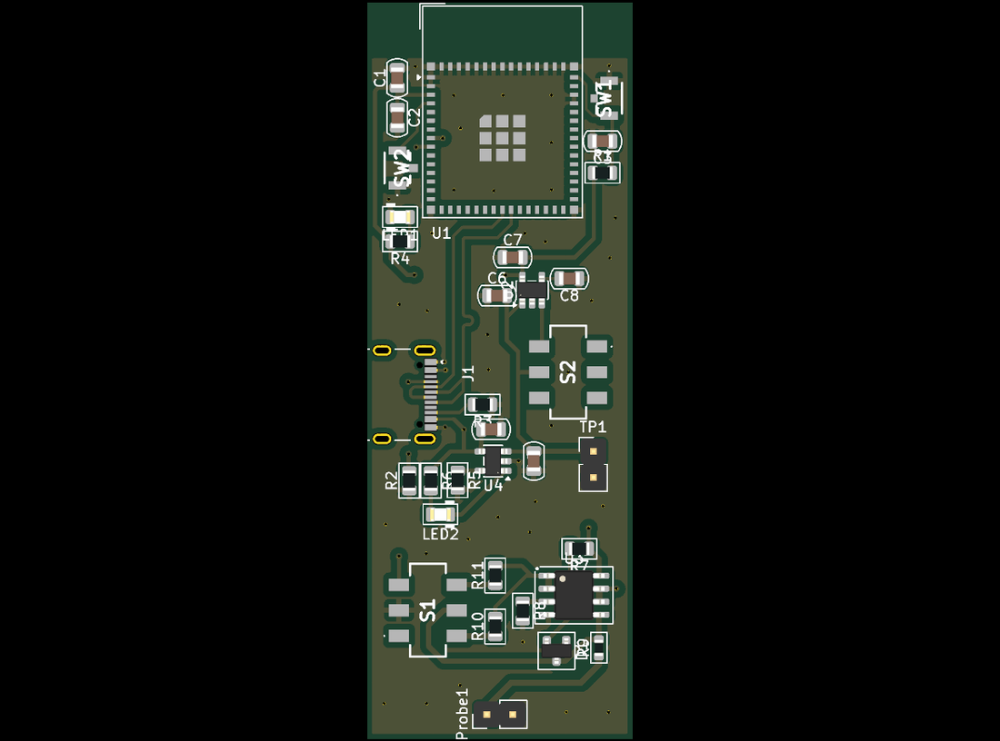
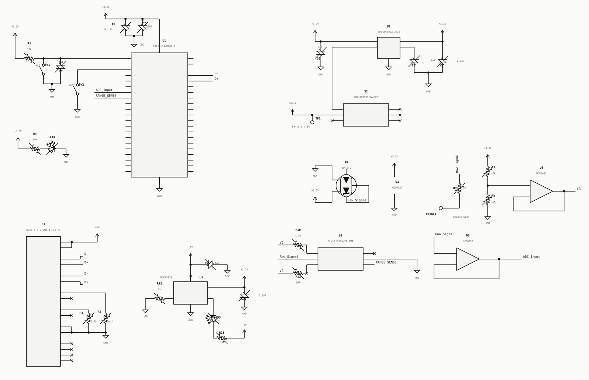

# Pocket Oscilloscope

> **A personal PCB design project.** A pocket-sized, battery-powered oscilloscope board built
> around an ESP32-S3.



## What it is

An oscilloscope draws electrical signals on a screen so you can see what a circuit is doing.
Bench oscilloscopes are large and live in the lab; this board puts the essentials on one narrow
board that fits in a pocket:

- **Probe input and front end.** The probe connects through a protected input
  (Schottky clamp to the rails) into op-amp buffer and scaling stages, with a switchable input
  range so both small and larger signals fit the ADC.
- **Sampling.** An ESP32-S3-MINI-1 module digitizes the signal; its USB and wireless links can
  carry the waveform to a computer or phone for display.
- **Power.** A single-cell LiPo battery with an on-board USB-C charger and a 3.3 V regulator,
  so it runs untethered.
- **Controls.** Reset and boot buttons, status LEDs and test points for bring-up.



## Repository structure

```
pocket-oscilloscope/
├── hardware/
│   ├── pocket_oscilloscope.kicad_pro   # KiCad project (open this)
│   ├── pocket_oscilloscope.kicad_sch   # schematic
│   ├── pocket_oscilloscope.kicad_pcb   # board layout
│   ├── fp-lib-table
│   └── fabrication/pocket_oscilloscope-gerbers.zip
└── docs/images/
```

## Opening the design

Open `hardware/pocket_oscilloscope.kicad_pro` in KiCad 8 or newer. Some parts use the
KiCad PCM "AKL" libraries; install them from the Plugin and Content Manager if symbols show
as missing.

## Status

Board design complete, with fabrication files. Firmware is not part of this repository yet.

---

**Author:** Yaşar Aykut Altuntop · MSc student, Biomedical Sciences and Engineering, Koç University  
[LinkedIn](https://linkedin.com/in/aykutaltuntop) · [GitHub](https://github.com/Aykut0)
